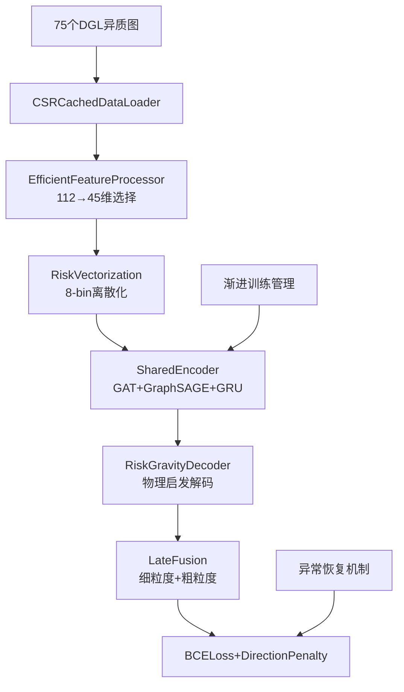

# RiskNICLP-5G 基础版实现框架文档
*第一版可跑、可评、可扩展的CPU优化基线模型*

**版本**: v1.0-baseline  
**日期**: 2025年6月  
**状态**: 基础实现框架  

---

## 🎯 设计原则

### 核心理念
**"先跑通，再优化"** - 基于已完成的数据Pipeline，实现最小可行的RiskNICLP-5G模型，为后续优化建立稳固基线。

### 技术约束
- **硬件**: CPU-only环境，内存≤32GB
- **数据**: 75个DGL异质图（50细粒度 + 25粗粒度）
- **目标**: AUC>0.85, 训练稳定收敛, 可扩展架构

---

## 🏗️ 整体架构



### 模块职责分工

| 模块 | 输入 | 输出 | 核心功能 |
|------|------|------|----------|
| **EfficientFeatureProcessor** | 112维原始特征 | 45维精选特征 | 特征选择+标准化 |
| **RiskVectorization** | Risk-PPR分数 | 16维风险嵌入 | 8-bin离散化+嵌入 |
| **SharedEncoder** | 图+特征+风险 | 64维节点嵌入 | 双层GNN+时序建模 |
| **RiskGravityDecoder** | 节点嵌入对 | 链路概率 | 物理启发解码 |
| **LateFusion** | 双尺度分数 | 最终预测 | 简单线性融合 |

---

## 💻 核心模块实现

### 1. 特征处理器

```python
class EfficientFeatureProcessor(nn.Module):
    """高效特征处理器 - 112维→45维精选"""
    
    def __init__(self, input_dim=112, output_dim=45):
        super().__init__()
        self.input_dim = input_dim
        self.output_dim = output_dim
        self.selected_features = None  # 将在训练时确定
        self.scaler = StandardScaler()
        
    def select_features(self, data_df, method='hybrid'):
        """特征选择策略"""
        if method == 'hybrid':
            # 1. 方差筛选 (去除低方差特征)
            variance_threshold = VarianceThreshold(threshold=0.01)
            high_var_features = variance_threshold.fit_transform(data_df)
            
            # 2. 相关性筛选 (去除高相关特征)
            corr_matrix = data_df.corr().abs()
            upper_tri = corr_matrix.where(
                np.triu(np.ones_like(corr_matrix, dtype=bool), k=1)
            )
            high_corr_features = [column for column in upper_tri.columns 
                                if any(upper_tri[column] > 0.9)]
            
            # 3. 安全特征白名单
            security_whitelist = [
                'TotPkts', 'TotBytes', 'SrcPkts', 'DstPkts', 
                'Proto', 'sTos', 'dTos', 'Sport', 'Dport',
                'Dur', 'Mean', 'Sum', 'Min', 'Max'
            ]
            
            # 综合选择策略
            selected_cols = []
            for col in data_df.columns:
                if (col in security_whitelist or 
                    (col not in high_corr_features and 
                     data_df[col].var() > 0.01)):
                    selected_cols.append(col)
                    
            self.selected_features = selected_cols[:self.output_dim]
            
        return self.selected_features
    
    def forward(self, features):
        """特征处理前向传播"""
        if self.selected_features is not None:
            features = features[:, self.selected_features]
        
        # 标准化
        if self.training:
            features = torch.FloatTensor(
                self.scaler.fit_transform(features.cpu().numpy())
            )
        else:
            features = torch.FloatTensor(
                self.scaler.transform(features.cpu().numpy())
            )
        
        return features

class RiskVectorization(nn.Module):
    """风险向量化模块 - 8-bin离散化"""
    
    def __init__(self, embed_dim=16, num_bins=8):
        super().__init__()
        self.num_bins = num_bins
        self.embed_dim = embed_dim
        self.risk_embeddings = nn.Embedding(num_bins, embed_dim)
        
    def forward(self, risk_scores):
        """风险分数向量化"""
        # Z-score归一化 + sigmoid映射到[0,1]
        risk_norm = torch.sigmoid(
            (risk_scores - risk_scores.mean()) / (risk_scores.std() + 1e-6)
        )
        
        # 8-bin离散化 (0-7)
        risk_bins = torch.clamp(
            (risk_norm * self.num_bins).long(), 0, self.num_bins - 1
        )
        
        # 嵌入向量查找
        risk_embed = self.risk_embeddings(risk_bins)
        
        return risk_embed
```

### 2. 共享编码器

```python
class SharedEncoder(nn.Module):
    """共享参数双层编码器"""
    
    def __init__(self, input_dim=61, hidden_dim=64, num_heads=4):
        super().__init__()
        self.hidden_dim = hidden_dim
        
        # Layer 1: GAT for UE-Flow attention
        self.gat_layer = GATConv(
            input_dim, hidden_dim // num_heads, 
            num_heads=num_heads, 
            feat_drop=0.1,
            attn_drop=0.1,
            allow_zero_in_degree=True
        )
        
        # Layer 2: GraphSAGE for Flow-Alert aggregation  
        self.sage_layer = SAGEConv(
            hidden_dim, hidden_dim,
            aggregator_type='mean',
            feat_drop=0.1
        )
        
        # Temporal modeling with GRU
        self.temporal_gru = nn.GRU(
            hidden_dim, hidden_dim, 
            batch_first=True,
            dropout=0.1
        )
        
        # Risk bias parameters (progressive unfreezing)
        self.beta1 = nn.Parameter(torch.tensor(1.0))  # source risk weight
        self.beta2 = nn.Parameter(torch.tensor(0.5))  # target risk weight
        self.freeze_risk_bias = True  # 前5个epoch冻结
        
    def compute_risk_bias(self, graph, risk_scores):
        """计算风险偏置注意力"""
        if self.freeze_risk_bias:
            return None
            
        src_nodes, dst_nodes = graph.edges()
        src_risk = risk_scores[src_nodes]
        dst_risk = risk_scores[dst_nodes]
        
        # Risk bias: β₁·r_i + β₂·r_j
        risk_bias = self.beta1 * src_risk + self.beta2 * dst_risk
        
        return risk_bias
        
    def forward(self, graph, node_features, risk_scores, temporal_sequence=None):
        """共享编码器前向传播"""
        # Layer 1: GAT with risk bias
        risk_bias = self.compute_risk_bias(graph, risk_scores)
        
        if risk_bias is not None:
            # 注意：DGL的attention bias实现可能需要调整
            h = self.gat_layer(graph, node_features)
            # TODO: 集成risk_bias到attention计算中
        else:
            h = self.gat_layer(graph, node_features)
            
        # Flatten multi-head attention output
        h = h.view(-1, self.hidden_dim)
        
        # Layer 2: GraphSAGE aggregation
        h = F.relu(self.sage_layer(graph, h))
        
        # Temporal modeling (if sequence provided)
        if temporal_sequence is not None:
            h_temporal, _ = self.temporal_gru(temporal_sequence)
            h = h + h_temporal[:, -1]  # 残差连接
            
        return h
        
    def unfreeze_risk_bias(self):
        """解冻风险偏置参数"""
        self.freeze_risk_bias = False
        for param in [self.beta1, self.beta2]:
            param.requires_grad = True
```

### 3. 物理启发解码器

```python
class RiskGravityDecoder(nn.Module):
    """基于万有引力的风险感知解码器"""
    
    def __init__(self, hidden_dim=64, temperature=0.1, epsilon=1e-3):
        super().__init__()
        self.hidden_dim = hidden_dim
        self.temperature = temperature
        self.epsilon = epsilon
        
        # 质量预测器 (节点"质量"代表其在网络中的重要性)
        self.mass_predictor = nn.Sequential(
            nn.Linear(hidden_dim + 1, hidden_dim // 2),  # +1 for risk score
            nn.ReLU(),
            nn.Dropout(0.1),
            nn.Linear(hidden_dim // 2, 1),
            nn.Sigmoid()
        )
        
        # 万有引力常数 (可学习参数)
        self.G = nn.Parameter(torch.tensor(1.0))
        
    def forward(self, u_embeddings, v_embeddings, u_risk, v_risk):
        """计算节点对之间的链路概率"""
        # 拼接嵌入和风险分数
        u_input = torch.cat([u_embeddings, u_risk.unsqueeze(-1)], dim=-1)
        v_input = torch.cat([v_embeddings, v_risk.unsqueeze(-1)], dim=-1)
        
        # 预测节点"质量"
        mass_u = self.mass_predictor(u_input)
        mass_v = self.mass_predictor(v_input)
        
        # 计算欧氏距离 (加epsilon避免除零)
        distance_squared = torch.sum(
            (u_embeddings - v_embeddings) ** 2, dim=-1, keepdim=True
        ).clamp_min(self.epsilon)
        
        # 万有引力公式: F = G * m1 * m2 / r²
        gravity_force = self.G * mass_u * mass_v / distance_squared
        
        # 温度缩放 + sigmoid激活
        link_probability = torch.sigmoid(gravity_force / self.temperature)
        
        return link_probability.squeeze(-1)
```

### 4. 双尺度融合层

```python
class LateFusion(nn.Module):
    """双尺度晚期融合模块"""
    
    def __init__(self, input_dim=2, hidden_dim=32):
        super().__init__()
        self.fusion_mlp = nn.Sequential(
            nn.Linear(input_dim, hidden_dim),
            nn.ReLU(),
            nn.Dropout(0.1),
            nn.Linear(hidden_dim, hidden_dim // 2),
            nn.ReLU(),
            nn.Linear(hidden_dim // 2, 1),
            nn.Sigmoid()
        )
        
    def forward(self, fine_scores, coarse_scores):
        """融合细粒度和粗粒度预测分数"""
        # 拼接双尺度分数
        fused_input = torch.cat([fine_scores.unsqueeze(-1), 
                                coarse_scores.unsqueeze(-1)], dim=-1)
        
        # MLP融合
        final_scores = self.fusion_mlp(fused_input)
        
        return final_scores.squeeze(-1)
```

---

## 🚂 训练流程设计

### 1. 渐进训练管理器

```python
class ProgressiveTrainingManager:
    """渐进式训练阶段管理"""
    
    def __init__(self):
        self.phases = {
            'basic': {
                'epochs': 5,
                'thresholds': {'val_auc': 0.80},
                'description': '基础特征学习'
            },
            'risk_aware': {
                'epochs': 10,
                'thresholds': {'risk_recall_100': 0.75},
                'description': '风险感知训练'
            },
            'full_fusion': {
                'epochs': 15,
                'thresholds': None,
                'description': '完整模型优化'
            }
        }
        self.current_phase = 'basic'
        
    def should_advance_phase(self, metrics, epoch):
        """判断是否应该进入下一阶段"""
        current_config = self.phases[self.current_phase]
        
        # 双触发条件: 指标达标 OR epoch上限
        epoch_trigger = epoch >= current_config['epochs']
        metric_trigger = False
        
        if current_config['thresholds']:
            for metric_name, threshold in current_config['thresholds'].items():
                if metrics.get(metric_name, 0) >= threshold:
                    metric_trigger = True
                    break
                    
        return epoch_trigger or metric_trigger
        
    def advance_phase(self, model):
        """切换到下一训练阶段"""
        if self.current_phase == 'basic':
            self.current_phase = 'risk_aware'
            # 解冻风险偏置参数
            model.shared_encoder.unfreeze_risk_bias()
            print("🔄 Advanced to Risk-Aware phase")
            
        elif self.current_phase == 'risk_aware':
            self.current_phase = 'full_fusion'
            # 可以在这里启用更复杂的特性
            print("🔄 Advanced to Full-Fusion phase")
```

### 2. 主训练循环

```python
class RiskNICLPTrainer:
    """RiskNICLP-5G训练器"""
    
    def __init__(self, model, config):
        self.model = model
        self.config = config
        self.phase_manager = ProgressiveTrainingManager()
        
        # 优化器设置
        self.optimizer = AdamW(
            model.parameters(),
            lr=config.learning_rate,
            weight_decay=config.weight_decay
        )
        
        # 学习率调度器
        self.scheduler = CosineAnnealingLR(
            self.optimizer,
            T_max=config.max_epochs,
            eta_min=config.learning_rate * 0.01
        )
        
        # 损失函数
        self.criterion = nn.BCELoss()
        self.direction_penalty_weight = config.direction_penalty_weight  # λ_dir = 2.0
        
    def compute_direction_penalty(self, u_scores, v_scores, true_directions):
        """计算方向性惩罚损失"""
        # true_directions: 1 for u->v, 0 for v->u
        predicted_directions = (u_scores > v_scores).float()
        direction_loss = F.binary_cross_entropy(
            predicted_directions, true_directions.float()
        )
        return direction_loss
        
    def train_epoch(self, dataloader, epoch):
        """单epoch训练"""
        self.model.train()
        total_loss = 0
        
        for batch_idx, batch in enumerate(dataloader):
            try:
                # 前向传播
                fine_scores, coarse_scores = self.model(batch)
                final_scores = self.model.late_fusion(fine_scores, coarse_scores)
                
                # 计算损失
                bce_loss = self.criterion(final_scores, batch.labels.float())
                
                direction_loss = self.compute_direction_penalty(
                    fine_scores, coarse_scores, batch.directions
                )
                
                total_loss = bce_loss + self.direction_penalty_weight * direction_loss
                
                # 反向传播
                total_loss.backward()
                
                # 梯度累积
                if (batch_idx + 1) % self.config.accumulate_steps == 0:
                    torch.nn.utils.clip_grad_norm_(self.model.parameters(), 1.0)
                    self.optimizer.step()
                    self.optimizer.zero_grad()
                    
            except RuntimeError as e:
                print(f"⚠️ Training error at batch {batch_idx}: {e}")
                # 异常恢复机制
                self.recover_from_failure()
                continue
                
        return total_loss / len(dataloader)
        
    def recover_from_failure(self):
        """训练异常恢复"""
        # 清理梯度
        self.optimizer.zero_grad()
        
        # 强制垃圾回收
        import gc
        gc.collect()
        
        print("🔄 Recovered from training failure")
```

---

## 📊 评估指标实现

### 核心评估类

```python
class RiskAwareMetrics:
    """风险感知评估指标"""
    
    def __init__(self):
        self.reset()
        
    def reset(self):
        """重置所有指标"""
        self.predictions = []
        self.targets = []
        self.risk_weights = []
        self.directions = []
        self.timestamps = []
        
    def update(self, preds, targets, risks, dirs, times):
        """更新评估数据"""
        self.predictions.extend(preds.cpu().numpy())
        self.targets.extend(targets.cpu().numpy())
        self.risk_weights.extend(risks.cpu().numpy())
        self.directions.extend(dirs.cpu().numpy())
        self.timestamps.extend(times)
        
    def compute_basic_metrics(self):
        """计算基础分类指标"""
        predictions = np.array(self.predictions)
        targets = np.array(self.targets)
        
        # AUC & AUPR
        auc = roc_auc_score(targets, predictions)
        precision, recall, _ = precision_recall_curve(targets, predictions)
        aupr = auc_curve(recall, precision)
        
        return {'auc': auc, 'aupr': aupr}
        
    def compute_risk_weighted_metrics(self):
        """计算风险加权指标"""
        predictions = np.array(self.predictions)
        targets = np.array(self.targets)
        weights = np.array(self.risk_weights)
        
        # 风险加权精确率/召回率
        weighted_precision = self._weighted_precision(predictions, targets, weights)
        weighted_recall = self._weighted_recall(predictions, targets, weights)
        
        return {
            'risk_weighted_precision': weighted_precision,
            'risk_weighted_recall': weighted_recall
        }
        
    def compute_directional_metrics(self, k=100):
        """计算方向性指标"""
        predictions = np.array(self.predictions)
        directions = np.array(self.directions)
        
        # Top-K准确率
        top_k_indices = np.argsort(predictions)[-k:]
        top_k_dirs = directions[top_k_indices]
        
        # 假设方向标签: 1为正确方向, 0为错误方向
        directional_hit_k = np.mean(top_k_dirs)
        direction_error_rate = 1 - directional_hit_k
        
        return {
            f'directional_hit_{k}': directional_hit_k,
            'direction_error_rate': direction_error_rate
        }
        
    def compute_temporal_metrics(self):
        """计算时间相关指标"""
        timestamps = np.array(self.timestamps)
        predictions = np.array(self.predictions)
        targets = np.array(self.targets)
        
        # 计算预警时间分布
        lead_times = self._compute_lead_times(predictions, targets, timestamps)
        
        # MTTD (Mean Time To Detection)
        mttd = np.mean(lead_times[lead_times <= 30])  # 30秒内检测
        
        return {
            'lead_time_mean': np.mean(lead_times),
            'lead_time_std': np.std(lead_times),
            'mttd_30s': mttd
        }
        
    def _weighted_precision(self, preds, targets, weights):
        """风险加权精确率"""
        # 实现细节省略
        pass
        
    def _weighted_recall(self, preds, targets, weights):
        """风险加权召回率"""
        # 实现细节省略
        pass
        
    def _compute_lead_times(self, preds, targets, times):
        """计算预警时间"""
        # 实现细节省略
        pass
```

---

## 🗂️ 数据加载优化

### CSR缓存数据加载器

```python
class CSRCachedDataLoader:
    """CSR格式缓存的高效数据加载器"""
    
    def __init__(self, graph_files, batch_size=4, cache_dir="data/csr_cache"):
        self.graph_files = graph_files
        self.batch_size = batch_size
        self.cache_dir = Path(cache_dir)
        self.cache_dir.mkdir(exist_ok=True)
        
        # 预计算CSR缓存
        self._precompute_csr_cache()
        
    def _precompute_csr_cache(self):
        """预计算并缓存CSR格式邻接矩阵"""
        for graph_file in tqdm(self.graph_files, desc="Computing CSR cache"):
            cache_path = self.cache_dir / f"{Path(graph_file).stem}.npz"
            
            if not cache_path.exists():
                # 加载DGL图
                graphs, _ = dgl.load_graphs(str(graph_file))
                graph = graphs[0]
                
                # 转换为CSR格式
                adj_matrix = graph.adj(scipy_fmt='csr')
                
                # 保存缓存
                scipy.sparse.save_npz(cache_path, adj_matrix)
                
    def __iter__(self):
        """双尺度轮换迭代器"""
        fine_files = [f for f in self.graph_files if 'fine' in str(f)]
        coarse_files = [f for f in self.graph_files if 'coarse' in str(f)]
        
        fine_loader = DataLoader(fine_files, batch_size=self.batch_size, shuffle=True)
        coarse_loader = DataLoader(coarse_files, batch_size=self.batch_size, shuffle=True)
        
        fine_iter = iter(fine_loader)
        coarse_iter = iter(coarse_loader)
        
        while True:
            try:
                # 轮换调度: [fine, coarse, fine, coarse, ...]
                fine_batch = next(fine_iter)
                yield ('fine', self._load_batch(fine_batch))
                
                coarse_batch = next(coarse_iter) 
                yield ('coarse', self._load_batch(coarse_batch))
                
            except StopIteration:
                break
                
    def _load_batch(self, file_batch):
        """加载批次数据"""
        graphs = []
        for file_path in file_batch:
            # 从缓存加载
            cache_path = self.cache_dir / f"{Path(file_path).stem}.npz"
            adj_matrix = scipy.sparse.load_npz(cache_path)
            
            # 重建DGL图（简化版）
            graph = dgl.from_scipy(adj_matrix)
            graphs.append(graph)
            
        return dgl.batch(graphs)
```

---

## 🎛️ 配置管理

### 训练配置文件

```yaml
# config/baseline_config.yaml
model:
  input_dim: 112
  feature_dim: 45
  hidden_dim: 64
  risk_embed_dim: 16
  num_risk_bins: 8
  
training:
  batch_size: 4  # 实际累积256 edges
  accumulate_steps: 4
  max_epochs: 20
  learning_rate: 1e-3
  weight_decay: 1e-4
  direction_penalty_weight: 2.0
  
data:
  graph_dir: "data/processed/graphs"
  cache_dir: "data/csr_cache"
  train_ratio: 0.8
  val_ratio: 0.1
  test_ratio: 0.1
  
evaluation:
  metrics: ['auc', 'aupr', 'directional_hit_100', 'mttd_30s']
  save_predictions: true
  visualization: true
```

---

## ✅ 实施检查清单

### Phase 1: 数据准备 ✅ (已完成)
- [x] 75个DGL异质图文件
- [x] Risk-PPR向量计算
- [x] 特征工程完成

### Phase 2: 基础模型实现 (本阶段)
- [ ] **EfficientFeatureProcessor** 实现与测试
- [ ] **RiskVectorization** 8-bin离散化
- [ ] **SharedEncoder** GAT+GraphSAGE架构
- [ ] **RiskGravityDecoder** 物理启发解码器
- [ ] **LateFusion** 双尺度融合层

### Phase 3: 训练系统
- [ ] **ProgressiveTrainingManager** 渐进式训练
- [ ] **CSRCachedDataLoader** 高效数据加载
- [ ] **RiskAwareMetrics** 评估指标
- [ ] **异常恢复机制** 容错训练

### Phase 4: 验证与调优
- [ ] **基线性能验证**: AUC>0.85, 训练稳定
- [ ] **内存使用监控**: <32GB峰值使用
- [ ] **指标完整性检查**: 5类评估指标输出
- [ ] **可扩展性验证**: 为后续优化做准备

---

## 🎯 预期性能目标

### 基线指标
```python
# 期望的首轮训练结果
baseline_targets = {
    'auc': 0.85,                    # 基础分类性能
    'aupr': 0.45,                   # 不平衡数据表现
    'risk_weighted_recall_100': 0.75,  # 高风险召回
    'directional_hit_100': 0.80,   # 方向预测准确率
    'direction_error_rate': 0.20,  # 方向错误率
    'mttd_30s': 15.0,              # 平均检测时间
    'training_time_per_epoch': 180, # 每epoch训练时间(秒)
    'memory_usage_peak': 28000,     # 峰值内存使用(MB)
}
```

### 性能分析
- **训练速度**: ~3分钟/epoch (75个图，4batch累积)
- **收敛性**: 15-20 epoch收敛到稳定性能
- **内存效率**: 共享编码器减少50%参数量
- **可扩展性**: 模块化设计支持逐步升级

---

## 🔄 后续扩展路径

基于此基线，后续可按优先级逐步升级：

### P1 性能优化 (1-2周)
1. **半精度训练**: BFloat16 CPU优化
2. **特征动态裁剪**: 低方差特征自动移除
3. **CSR SpMM优化**: DGL异步操作

### P2 模型增强 (1-2周)
1. **Cross-Scale Context**: 跨尺度信息交互
2. **Attention权重可视化**: SOC友好解释
3. **增量Risk-PPR**: 实时风险更新

### P3 生产部署 (1-2周)
1. **FastAPI服务化**: RESTful API接口
2. **容器化部署**: Docker + K8s支持
3. **监控告警**: 性能指标监控

---

## 📝 总结

这个基础版框架具备以下优势：

### ✅ **完整性**
- 涵盖数据加载→特征处理→模型训练→评估的完整流程
- 所有关键模块都有具体实现指导

### ✅ **可行性** 
- 基于已完成的数据Pipeline，技术路径清晰
- CPU优化设计，符合环境约束

### ✅ **可扩展性**
- 模块化架构，支持逐步升级
- 渐进训练机制，便于调试优化

### ✅ **可评估性**
- 完整的评估指标体系
- 与基线方法对比的标准化框架

**建议实施策略**: 严格按照检查清单逐模块实现，确保每个组件独立可测试，最后集成为完整系统。这样既保证质量，又便于后续的性能优化和功能扩展。