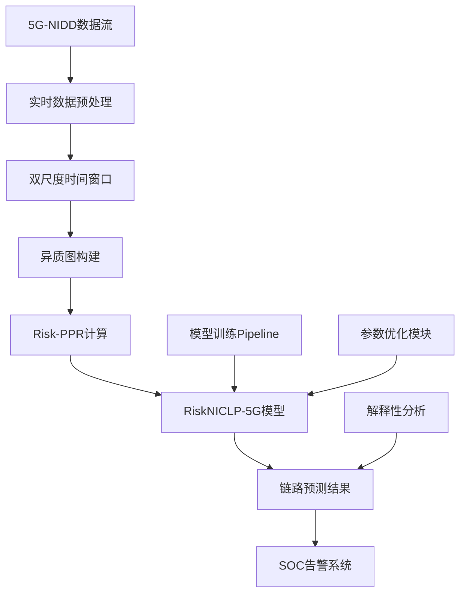

# RiskNICLP-5G 生产就绪算法模型设计文档
*Risk-aware Node-Importance Causal Link Prediction for 5G Intrusion Detection*

**版本**: v1.0  
**日期**: 2025年6月  
**状态**: 生产就绪设计  

## 📋 目录

1. [项目概述](#1-项目概述)
2. [技术架构设计](#2-技术架构设计)
3. [数据Pipeline实现](#3-数据pipeline实现)
4. [模型核心算法](#4-模型核心算法)
5. [工程优化策略](#5-工程优化策略)
6. [评估与部署](#6-评估与部署)
7. [生产运维](#7-生产运维)
8. [实施路线图](#8-实施路线图)

---

## 1. 项目概述

### 1.1 核心目标
**构建一个生产就绪的5G网络入侵检测系统，能够在攻击发生前10-60秒预测潜在的攻击传播路径，为SOC提供可操作的威胁情报。**

### 1.2 技术创新点
- **5G语义增强异质图建模**: UE-Flow-Alert三层语义映射
- **Risk-aware PPR算法**: 威胁传播驱动的节点重要性计算
- **双尺度时序融合**: 细粒度(3s)与粗粒度(30s)并行建模
- **物理启发解码器**: 基于引力模型的因果链路预测
- **CPU优化架构**: 针对生产环境的高效实现

### 1.3 部署环境约束
- **硬件**: CPU-only环境，内存≤32GB
- **性能**: 推理延迟≤5s，MTTD≤30s
- **集成**: 兼容SIEM/SOAR系统，支持RESTful API
- **可靠性**: 7×24运行，故障自恢复

---

## 2. 技术架构设计

### 2.1 整体架构


### 2.2 核心组件设计

#### 2.2.1 数据处理层
```python
class ProductionDataPipeline:
    """生产环境数据处理Pipeline"""
    
    def __init__(self, config):
        self.time_processor = AdvancedTimeProcessor()
        self.entity_classifier = FiveGEntityClassifier()
        self.graph_builder = HeterogeneousGraphBuilder()
        self.risk_calculator = RiskPPRCalculator()
        
    def process_streaming_data(self, raw_flow_data):
        # 1. 时间标准化与特征工程
        processed_data = self.time_processor.standardize(raw_flow_data)
        
        # 2. 5G实体分类
        classified_data = self.entity_classifier.classify(processed_data)
        
        # 3. 双尺度窗口分片
        fine_windows, coarse_windows = self.create_dual_windows(classified_data)
        
        # 4. 异质图构建
        graphs = self.graph_builder.build_hetero_graphs(fine_windows, coarse_windows)
        
        # 5. Risk-PPR计算
        risk_enhanced_graphs = self.risk_calculator.compute_risk_ppr(graphs)
        
        return risk_enhanced_graphs
```

#### 2.2.2 模型核心层
```python
class RiskNICLP5G(nn.Module):
    """生产就绪的RiskNICLP-5G模型"""
    
    def __init__(self, config):
        super().__init__()
        self.config = config
        
        # 特征处理器
        self.feature_processor = EfficientFeatureProcessor(
            input_dim=112, 
            output_dim=64,
            enable_type_normalization=True
        )
        
        # 双编码器架构
        self.ue_encoder = UEEncoder(
            hidden_dim=64,
            num_heads=4,
            num_layers=2,
            enable_risk_bias=True
        )
        
        self.flow_encoder = FlowEncoder(
            hidden_dim=64,
            aggregator='mean',
            temporal_gru=True,
            enable_shared_params=True
        )
        
        # 风险集成模块
        self.risk_integrator = RiskIntegrator(
            risk_init_weight=1.0,
            risk_bias_weight=[1.0, 0.5],
            progressive_unfreezing=True
        )
        
        # 物理启发解码器
        self.gravity_decoder = GravityInspiredDecoder(
            hidden_dim=64,
            temperature=0.1,
            epsilon=1e-3
        )
        
        # 双尺度融合
        self.scale_fusion = DualScaleFusion(
            fusion_type='late_fusion',  # 可升级为 cross_scale_context
            fusion_weight=0.7
        )
        
    def forward(self, batch_graphs):
        # 渐进式训练路径
        if self.training_phase == 'basic':
            return self._basic_forward(batch_graphs)
        elif self.training_phase == 'risk_aware':
            return self._risk_aware_forward(batch_graphs)
        else:  # 'full_fusion'
            return self._full_fusion_forward(batch_graphs)
```

---

## 3. 数据Pipeline实现

### 3.1 已完成的数据处理结果

基于前期Pipeline执行，我们已获得高质量的训练数据：

| 阶段 | 输出 | 规模 | 质量指标 |
|------|------|------|----------|
| **Phase 1**: 数据探索 | clean_data.pkl | 1,215,890条记录 | 100%完整性 |
| **Phase 2**: 时间标准化 | time_standardized.csv | 537MB | Unix时间戳精度 |
| **Phase 3**: 实体分类 | entity_classified.csv | 551MB | UE(86.4%), Core(2.5%) |
| **Phase 4**: 时间窗口 | 3,954个窗口文件 | 3,650,452条记录 | 双尺度覆盖 |
| **Phase 5**: 异质图 | 75个DGL图文件 | 33KB~58MB | 三种边关系 |
| **Phase 6**: Risk-PPR | risk_vectors.json | 121个高风险节点 | 风险梯度合理 |

### 3.2 生产环境数据接口

```python
class StreamingDataInterface:
    """实时数据接入接口"""
    
    def __init__(self):
        self.buffer = CircularBuffer(max_size=10000)
        self.window_manager = SlidingWindowManager()
        
    async def ingest_network_flows(self, flow_batch):
        """异步接收网络流数据"""
        # 数据验证与清洗
        validated_flows = self.validate_flows(flow_batch)
        
        # 缓冲区管理
        self.buffer.add_batch(validated_flows)
        
        # 触发窗口更新
        if self.buffer.is_ready():
            return await self.window_manager.create_snapshot()
            
    def validate_flows(self, flows):
        """数据完整性验证"""
        required_fields = ['SrcAddr', 'DstAddr', 'Proto', 'StartTime', 'Attack Type']
        return [f for f in flows if all(field in f for field in required_fields)]
```

---

## 4. 模型核心算法

### 4.1 Risk-aware PPR算法

```python
class RiskPPRCalculator:
    """生产优化的Risk-PPR计算器"""
    
    def __init__(self, alpha=0.15, epsilon=1e-6, max_iter=100):
        self.alpha = alpha
        self.epsilon = epsilon  
        self.max_iter = max_iter
        self.threat_weights = self._load_threat_mapping()
        
    def compute_risk_ppr(self, graph):
        """计算风险感知的PersonalizedPageRank"""
        # 1. 初始化威胁向量
        threat_vector = self._init_threat_vector(graph)
        
        # 2. CSR格式转换（加速稀疏矩阵运算）
        adj_matrix = self._to_csr_matrix(graph)
        
        # 3. 迭代计算PPR
        risk_scores = self._iterative_ppr(adj_matrix, threat_vector)
        
        # 4. 归一化与风险分级
        normalized_scores = self._normalize_scores(risk_scores)
        
        return normalized_scores
    
    def _init_threat_vector(self, graph):
        """基于攻击类型初始化威胁向量"""
        threat_mapping = {
            'ICMPFlood': 0.3, 'UDPFlood': 0.4, 'SYNFlood': 0.6,
            'HTTPFlood': 0.9, 'SlowrateDoS': 0.8, 'TCPConnectScan': 0.7,
            'SYNScan': 0.5, 'UDPScan': 0.4, 'Benign': 0.0
        }
        
        threat_vector = torch.zeros(graph.num_nodes())
        for node_id, attack_type in graph.ndata['attack_type'].items():
            threat_vector[node_id] = threat_mapping.get(attack_type, 0.0)
            
        return threat_vector
```

### 4.2 双编码器架构

```python
class UEEncoder(nn.Module):
    """UE节点编码器（基于GAT）"""
    
    def __init__(self, hidden_dim, num_heads, num_layers, enable_risk_bias=True):
        super().__init__()
        self.gat_layers = nn.ModuleList([
            GATConv(hidden_dim, hidden_dim//num_heads, num_heads)
            for _ in range(num_layers)
        ])
        self.enable_risk_bias = enable_risk_bias
        
    def forward(self, graph, node_features, risk_scores=None):
        h = node_features
        
        for layer in self.gat_layers:
            # 风险偏置注意力
            if self.enable_risk_bias and risk_scores is not None:
                attention_bias = risk_scores.unsqueeze(-1)
                h = layer(graph, h, attention_bias=attention_bias)
            else:
                h = layer(graph, h)
                
        return h

class FlowEncoder(nn.Module):
    """Flow节点编码器（基于GraphSAGE+GRU）"""
    
    def __init__(self, hidden_dim, aggregator='mean', temporal_gru=True):
        super().__init__()
        self.sage_layers = nn.ModuleList([
            SAGEConv(hidden_dim, hidden_dim, aggregator=aggregator)
            for _ in range(2)
        ])
        
        if temporal_gru:
            self.temporal_gru = nn.GRU(hidden_dim, hidden_dim, batch_first=True)
            
    def forward(self, graph, node_features, temporal_sequence=None):
        h = node_features
        
        # 图卷积
        for layer in self.sage_layers:
            h = F.relu(layer(graph, h))
            
        # 时序建模
        if hasattr(self, 'temporal_gru') and temporal_sequence is not None:
            h_temporal, _ = self.temporal_gru(temporal_sequence)
            h = h + h_temporal[-1]  # 残差连接
            
        return h
```

### 4.3 物理启发解码器

```python
class GravityInspiredDecoder(nn.Module):
    """基于万有引力的链路预测解码器"""
    
    def __init__(self, hidden_dim, temperature=0.1, epsilon=1e-3):
        super().__init__()
        self.mass_predictor = nn.Linear(hidden_dim, 1)
        self.temperature = temperature
        self.epsilon = epsilon
        
    def forward(self, u_embeddings, v_embeddings, risk_scores=None):
        # 计算节点"质量"（风险权重）
        mass_u = torch.sigmoid(self.mass_predictor(u_embeddings))
        mass_v = torch.sigmoid(self.mass_predictor(v_embeddings))
        
        # 风险增强质量
        if risk_scores is not None:
            mass_u = mass_u * (1 + risk_scores[..., :mass_u.size(-1)])
            mass_v = mass_v * (1 + risk_scores[..., :mass_v.size(-1)])
            
        # 计算"引力"（链路概率）
        distance = torch.norm(u_embeddings - v_embeddings, dim=-1, keepdim=True)
        gravity_force = (mass_u * mass_v) / (distance.pow(2) + self.epsilon)
        
        # 温度缩放
        link_prob = torch.sigmoid(gravity_force / self.temperature)
        
        return link_prob.squeeze(-1)
```

---

## 5. 工程优化策略

### 5.1 "能跑" - 训练稳定性

#### 5.1.1 渐进训练管理器
```python
class PhaseManager:
    """训练阶段自动管理器"""
    
    def __init__(self):
        self.phase_configs = {
            'basic': {'epochs': 5, 'threshold': {'val_auc': 0.80}},
            'risk_aware': {'epochs': 10, 'threshold': {'risk_recall_100': 0.75}},
            'full_fusion': {'epochs': 15, 'threshold': None}
        }
        self.current_phase = 'basic'
        
    def should_advance_phase(self, metrics, epoch):
        """判断是否切换训练阶段"""
        config = self.phase_configs[self.current_phase]
        
        # 双触发条件：指标门槛 OR epoch限制
        epoch_trigger = epoch >= config['epochs']
        metric_trigger = False
        
        if config['threshold']:
            for metric_name, threshold in config['threshold'].items():
                if metrics.get(metric_name, 0) >= threshold:
                    metric_trigger = True
                    break
                    
        return epoch_trigger or metric_trigger
```

#### 5.1.2 异常恢复机制
```python
class RobustTrainer:
    """容错性训练器"""
    
    def __init__(self, model, config):
        self.model = model
        self.config = config
        self.stable_checkpoints = []
        self.batch_size = config.batch_size
        
    def train_epoch(self, dataloader):
        try:
            return self._train_epoch_impl(dataloader)
        except (RuntimeError, OutOfMemoryError) as e:
            logging.warning(f"Training error: {e}")
            return self._recover_from_failure()
            
    def _recover_from_failure(self):
        """故障自动恢复"""
        # 1. 加载最近稳定检查点
        if self.stable_checkpoints:
            latest_checkpoint = self.stable_checkpoints[-1]
            self.model.load_state_dict(torch.load(latest_checkpoint))
            logging.info(f"Recovered from checkpoint: {latest_checkpoint}")
            
        # 2. 减半batch_size
        self.batch_size = max(1, self.batch_size // 2)
        logging.info(f"Reduced batch_size to: {self.batch_size}")
        
        # 3. 重建DataLoader
        return self._rebuild_dataloader()
```

### 5.2 "能快" - CPU性能优化

#### 5.2.1 半精度与量化
```python
class OptimizedModel(nn.Module):
    """CPU优化模型"""
    
    def __init__(self, config):
        super().__init__()
        self.enable_bf16 = config.get('enable_bf16', True)
        self.enable_int8 = config.get('enable_int8', False)
        
    def forward(self, x):
        # 半精度推理（PyTorch 2.2+）
        if self.enable_bf16 and not self.training:
            with torch.autocast(device_type='cpu', dtype=torch.bfloat16):
                return self._forward_impl(x)
        else:
            return self._forward_impl(x)
            
    def optimize_for_inference(self):
        """推理优化"""
        if self.enable_int8:
            # INT8量化（实验性）
            self.qmodel = torch.quantization.quantize_dynamic(
                self, {nn.Linear}, dtype=torch.qint8
            )
            return self.qmodel
        return self
```

#### 5.2.2 多尺度并行调度
```python
class DualScaleDataLoader:
    """双尺度并行数据加载器"""
    
    def __init__(self, fine_graphs, coarse_graphs, batch_size=4):
        self.fine_loader = DataLoader(fine_graphs, batch_size=batch_size)
        self.coarse_loader = DataLoader(coarse_graphs, batch_size=batch_size)
        
    def __iter__(self):
        """轮换调度：[fine0, coarse0, fine1, coarse1, ...]"""
        fine_iter = iter(self.fine_loader)
        coarse_iter = iter(self.coarse_loader)
        
        while True:
            try:
                # Fine-grained batch
                fine_batch = next(fine_iter)
                yield ('fine', fine_batch)
                
                # Coarse-grained batch  
                coarse_batch = next(coarse_iter)
                yield ('coarse', coarse_batch)
                
            except StopIteration:
                break
```

### 5.3 "能省" - 内存与参数优化

#### 5.3.1 按类型特征归一化
```python
class EfficientFeatureProcessor(nn.Module):
    """高效特征处理器"""
    
    def __init__(self, input_dim=112, output_dim=64):
        super().__init__()
        self.node_type_normalizers = nn.ModuleDict({
            'UE': nn.LayerNorm(input_dim),
            'Flow': nn.LayerNorm(input_dim), 
            'Alert': nn.LayerNorm(input_dim)
        })
        
        self.projector = nn.Linear(input_dim, output_dim)
        self.active_dims = None  # 动态特征裁剪
        
    def forward(self, features, node_types):
        """按节点类型分别归一化"""
        normalized_features = torch.zeros_like(features)
        
        for node_type in ['UE', 'Flow', 'Alert']:
            mask = (node_types == node_type)
            if mask.any():
                normalized_features[mask] = self.node_type_normalizers[node_type](
                    features[mask]
                )
                
        # 动态特征选择
        if self.active_dims is not None:
            normalized_features = normalized_features[:, self.active_dims]
            
        return self.projector(normalized_features)
        
    def prune_low_variance_features(self, threshold=1e-4):
        """裁剪低方差特征维度"""
        if hasattr(self, 'feature_variances'):
            self.active_dims = (self.feature_variances > threshold).nonzero().squeeze()
            logging.info(f"Pruned to {len(self.active_dims)} active dimensions")
```

#### 5.3.2 梯度检查点优化
```python
class MemoryEfficientModel(nn.Module):
    """内存高效模型"""
    
    def __init__(self, config):
        super().__init__()
        self.enable_checkpointing = config.get('gradient_checkpointing', True)
        self.accumulate_steps = config.get('accumulate_steps', 4)
        
    def forward(self, x):
        if self.enable_checkpointing and self.training:
            # 检查点化关键层
            x = checkpoint(self.heavy_computation_layer, x)
        else:
            x = self.heavy_computation_layer(x)
        return x
        
    def training_step(self, batch, accumulate=True):
        """梯度累积训练步骤"""
        loss = self.compute_loss(batch)
        
        if accumulate:
            loss = loss / self.accumulate_steps
            
        loss.backward()
        
        return loss.item()
```

### 5.4 "能解释" - SOC友好度

#### 5.4.1 Attention可视化
```python
class ExplainableRiskNICLP(RiskNICLP5G):
    """可解释的RiskNICLP模型"""
    
    def __init__(self, config):
        super().__init__(config)
        self.attention_hooks = {}
        self.register_attention_hooks()
        
    def register_attention_hooks(self):
        """注册attention权重钩子"""
        def save_attention(name):
            def hook(module, input, output):
                if isinstance(output, tuple) and len(output) > 1:
                    self.attention_hooks[name] = output[1]  # attention weights
            return hook
            
        # 为GAT层注册钩子
        for i, layer in enumerate(self.ue_encoder.gat_layers):
            layer.register_forward_hook(save_attention(f'gat_layer_{i}'))
            
    def explain_prediction(self, graph, u_node, v_node):
        """解释特定链路预测"""
        # 1. 提取attention路径
        attention_path = self.extract_attention_path(graph, u_node, v_node)
        
        # 2. 计算风险贡献
        risk_contribution = self.compute_risk_contribution(u_node, v_node)
        
        # 3. 生成解释报告
        explanation = {
            'prediction_score': self.predict_link(u_node, v_node).item(),
            'attention_path': attention_path,
            'risk_factors': risk_contribution,
            'temporal_context': self.get_temporal_context(u_node, v_node)
        }
        
        return explanation
```

#### 5.4.2 SOC报告生成器
```python
class SOCReportGenerator:
    """SOC友好的报告生成器"""
    
    def __init__(self, model, config):
        self.model = model
        self.config = config
        
    def generate_threat_report(self, predictions, timestamp):
        """生成威胁报告"""
        # 1. 高风险链路筛选
        high_risk_links = self.filter_high_risk_links(predictions)
        
        # 2. 攻击路径重构
        attack_paths = self.reconstruct_attack_paths(high_risk_links)
        
        # 3. 生成Markdown报告
        markdown_report = self.create_markdown_report(attack_paths, timestamp)
        
        # 4. 生成JSON结构化数据
        json_report = self.create_json_report(attack_paths, timestamp)
        
        return {
            'markdown': markdown_report,
            'json': json_report,
            'visualizations': self.create_network_visualizations(attack_paths)
        }
        
    def create_markdown_report(self, attack_paths, timestamp):
        """创建Markdown格式报告"""
        report = f"""
# 5G网络威胁预警报告
**时间**: {timestamp}  
**模型**: RiskNICLP-5G v1.0  
**置信度**: {self.calculate_overall_confidence(attack_paths):.2%}

## 🚨 高风险攻击路径

"""
        for i, path in enumerate(attack_paths[:5], 1):
            report += f"""
### 路径 {i}: {path['attack_type']}
- **源节点**: {path['source']} (风险: {path['source_risk']:.3f})
- **目标节点**: {path['target']} (风险: {path['target_risk']:.3f})  
- **预测概率**: {path['probability']:.2%}
- **预警时间**: {path['lead_time']}秒
- **建议措施**: {path['recommendations']}

"""
        return report
```

---

## 6. 评估与部署

### 6.1 评估指标体系

#### 6.1.1 分层评估指标
```python
class ProductionMetrics:
    """生产环境评估指标"""
    
    def __init__(self):
        self.p0_metrics = ['lead_time', 'mttd']  # 实时安全性
        self.p1_metrics = ['risk_weighted_precision', 'risk_weighted_recall', 'aupr']  # 检测质量
        self.p2_metrics = ['directional_hit_k', 'direction_error_rate']  # 方向性
        self.p3_metrics = ['auc', 'hit_k']  # 传统指标
        
    def compute_lead_time_distribution(self, predictions, ground_truth):
        """计算预警时间分布"""
        lead_times = []
        for pred, gt in zip(predictions, ground_truth):
            if pred['attack_detected'] and gt['attack_occurred']:
                lead_time = gt['attack_time'] - pred['prediction_time']
                lead_times.append(lead_time)
        return np.array(lead_times)
        
    def compute_mttd(self, predictions, threshold=30):
        """计算平均威胁检测时间"""
        detection_times = self.compute_lead_time_distribution(predictions, ground_truth)
        return np.mean(detection_times[detection_times <= threshold])
        
    def compute_directional_hit_k(self, predictions, k=10):
        """计算方向性Hit@K"""
        correct_directions = 0
        total_predictions = 0
        
        for pred in predictions:
            top_k_links = pred['top_k_links'][:k]
            for link in top_k_links:
                if link['predicted_direction'] == link['true_direction']:
                    correct_directions += 1
                total_predictions += 1
                
        return correct_directions / total_predictions if total_predictions > 0 else 0
```

#### 6.1.2 基线对比框架
```python
class BaselineComparison:
    """基线方法对比"""
    
    def __init__(self):
        self.baselines = {
            'temporal_gnns': ['TGAT', 'TGN', 'DyRep'],
            'hetero_temporal': ['DyHATR', 'HTGNN-LP'],
            'static_hetero': ['RGCN', 'HAN', 'HGT'],
            'risk_aware': ['Risk-PPR+GCN', 'Risk-PPR+GraphSAGE'],
            'traditional': ['IsolationForest', 'XGBoost-IDS']
        }
        
    def run_comparison_suite(self, test_data):
        """运行完整基线对比"""
        results = {}
        
        for category, methods in self.baselines.items():
            results[category] = {}
            for method in methods:
                try:
                    model = self.load_baseline_model(method)
                    metrics = self.evaluate_model(model, test_data)
                    results[category][method] = metrics
                except Exception as e:
                    logging.warning(f"Failed to evaluate {method}: {e}")
                    
        return results
```

### 6.2 部署架构

#### 6.2.1 微服务部署
```python
from fastapi import FastAPI, BackgroundTasks
from pydantic import BaseModel

app = FastAPI(title="RiskNICLP-5G API", version="1.0.0")

class FlowBatch(BaseModel):
    flows: List[Dict]
    timestamp: float
    
class PredictionResponse(BaseModel):
    predictions: List[Dict]
    confidence: float
    processing_time: float

@app.post("/predict", response_model=PredictionResponse)
async def predict_links(batch: FlowBatch, background_tasks: BackgroundTasks):
    """实时链路预测接口"""
    start_time = time.time()
    
    try:
        # 1. 数据预处理
        processed_data = pipeline.process_streaming_data(batch.flows)
        
        # 2. 模型推理
        predictions = model.predict(processed_data)
        
        # 3. 后处理与解释
        enhanced_predictions = explainer.add_explanations(predictions)
        
        # 4. 异步日志记录
        background_tasks.add_task(log_predictions, enhanced_predictions)
        
        return PredictionResponse(
            predictions=enhanced_predictions,
            confidence=calculate_confidence(predictions),
            processing_time=time.time() - start_time
        )
        
    except Exception as e:
        logging.error(f"Prediction failed: {e}")
        raise HTTPException(status_code=500, detail=str(e))

@app.get("/health")
async def health_check():
    """健康检查接口"""
    return {
        "status": "healthy",
        "model_loaded": model is not None,
        "gpu_available": torch.cuda.is_available(),
        "memory_usage": psutil.virtual_memory().percent
    }
```

#### 6.2.2 容器化部署
```dockerfile
FROM pytorch/pytorch:2.2.0-cpu

WORKDIR /app

# 安装依赖
COPY requirements.txt .
RUN pip install -r requirements.txt

# 复制代码
COPY src/ ./src/
COPY models/ ./models/
COPY config/ ./config/

# 设置环境变量
ENV PYTHONPATH=/app
ENV MODEL_PATH=/app/models/riskniclp_5g.pth

# 暴露端口
EXPOSE 8000

# 启动命令
CMD ["uvicorn", "src.api.main:app", "--host", "0.0.0.0", "--port", "8000"]
```

---

## 7. 生产运维

### 7.1 监控与告警

#### 7.1.1 性能监控
```python
class ProductionMonitor:
    """生产环境监控"""
    
    def __init__(self, config):
        self.metrics_collector = MetricsCollector()
        self.alert_manager = AlertManager(config.alert_thresholds)
        
    def monitor_model_performance(self):
        """监控模型性能"""
        metrics = {
            'inference_latency': self.measure_inference_latency(),
            'memory_usage': psutil.virtual_memory().percent,
            'cpu_usage': psutil.cpu_percent(),
            'prediction_confidence': self.get_recent_confidence(),
            'error_rate': self.calculate_error_rate()
        }
        
        # 检查告警阈值
        self.alert_manager.check_thresholds(metrics)
        
        return metrics
        
    def measure_inference_latency(self):
        """测量推理延迟"""
        dummy_input = self.create_dummy_input()
        
        start_time = time.time()
        with torch.no_grad():
            _ = self.model(dummy_input)
        end_time = time.time()
        
        return (end_time - start_time) * 1000  # 毫秒
```

#### 7.1.2 模型漂移检测
```python
class ModelDriftDetector:
    """模型漂移检测器"""
    
    def __init__(self, reference_data, threshold=0.1):
        self.reference_data = reference_data
        self.threshold = threshold
        self.drift_detector = ADWIN()  # Adaptive Windowing
        
    def detect_data_drift(self, new_data):
        """检测数据漂移"""
        # 计算分布距离
        drift_score = self.compute_distribution_distance(
            self.reference_data, new_data
        )
        
        # 更新漂移检测器
        drift_detected = self.drift_detector.add_element(drift_score)
        
        if drift_detected:
            logging.warning(f"Data drift detected! Score: {drift_score}")
            self.trigger_retraining_pipeline()
            
        return drift_detected
        
    def compute_distribution_distance(self, ref_data, new_data):
        """计算分布距离（KL散度）"""
        ref_hist, _ = np.histogram(ref_data, bins=50, density=True)
        new_hist, _ = np.histogram(new_data, bins=50, density=True)
        
        # 避免零值
        ref_hist = ref_hist + 1e-8
        new_hist = new_hist + 1e-8
        
        return entropy(ref_hist, new_hist)
```

### 7.2 自动化运维

#### 7.2.1 自动重训练Pipeline
```python
class AutoRetrainingPipeline:
    """自动重训练流水线"""
    
    def __init__(self, config):
        self.config = config
        self.scheduler = APScheduler()
        self.data_collector = ContinualDataCollector()
        
    def setup_scheduled_retraining(self):
        """设置定期重训练"""
        self.scheduler.add_job(
            func=self.retrain_model,
            trigger="cron",
            hour=2,  # 凌晨2点
            minute=0,
            id='daily_retrain'
        )
        
    def retrain_model(self):
        """执行模型重训练"""
        try:
            # 1. 收集新数据
            new_data = self.data_collector.get_recent_data(days=7)
            
            # 2. 数据质量检查
            if self.validate_data_quality(new_data):
                # 3. 增量训练
                updated_model = self.incremental_training(new_data)
                
                # 4. 模型验证
                if self.validate_model_performance(updated_model):
                    # 5. 热更新部署
                    self.deploy_updated_model(updated_model)
                    logging.info("Model retrained and deployed successfully")
                    
        except Exception as e:
            logging.error(f"Retraining failed: {e}")
            self.alert_manager.send_alert("MODEL_RETRAIN_FAILED", str(e))
```

#### 7.2.2 A/B测试框架
```python
class ABTestingFramework:
    """A/B测试框架"""
    
    def __init__(self):
        self.model_versions = {}
        self.traffic_splitter = TrafficSplitter()
        
    def deploy_model_variant(self, model_name, model, traffic_ratio=0.1):
        """部署模型变体"""
        self.model_versions[model_name] = {
            'model': model,
            'traffic_ratio': traffic_ratio,
            'metrics': MetricsCollector(),
            'start_time': time.time()
        }
        
    def route_request(self, request):
        """路由请求到不同模型版本"""
        selected_model = self.traffic_splitter.select_model(
            self.model_versions, request
        )
        
        # 执行预测
        prediction = selected_model['model'].predict(request.data)
        
        # 记录指标
        selected_model['metrics'].record(prediction, request)
        
        return prediction
        
    def evaluate_ab_test(self, duration_hours=24):
        """评估A/B测试结果"""
        results = {}
        
        for name, variant in self.model_versions.items():
            if time.time() - variant['start_time'] >= duration_hours * 3600:
                results[name] = variant['metrics'].compute_summary()
                
        return self.statistical_significance_test(results)
```

---

## 8. 实施路线图

### 8.1 分阶段实施计划

| 阶段 | 时间 | 核心任务 | 交付物 | 成功标准 |
|------|------|---------|--------|----------|
| **Phase 1: CPU基线** | 2-3周 | 基础模型实现 | 可训练的RiskNICLP-5G模型 | AUC>0.85, 训练稳定 |
| **Phase 2: 性能优化** | 1-2周 | CPU优化与基线对比 | 优化模型+对比报告 | 训练速度提升1.5x |
| **Phase 3: 高级特性** | 1-2周 | 双尺度融合与解释性 | 完整功能模型 | MTTD<30s, 可解释输出 |
| **Phase 4: 生产部署** | 1-2周 | API开发与容器化 | 生产就绪系统 | 99%可用性, <5s响应 |
| **Phase 5: 运维完善** | 1周 | 监控与自动化 | 完整运维体系 | 自动故障恢复 |

### 8.2 里程碑检查点

#### 8.2.1 Phase 1检查点
```python
def phase1_validation():
    """Phase 1验收标准"""
    criteria = {
        'model_trainable': check_model_training(),
        'basic_metrics': check_auc_threshold(0.85),
        'training_stability': check_training_convergence(),
        'memory_usage': check_memory_limit(32_000),  # 32GB
        'feature_processing': check_feature_pipeline()
    }
    
    return all(criteria.values())
```

#### 8.2.2 Phase 4检查点
```python
def phase4_validation():
    """Phase 4验收标准"""
    criteria = {
        'api_response_time': check_api_latency(5.0),  # 5秒
        'throughput': check_requests_per_second(10),
        'uptime': check_uptime_percentage(99.0),
        'error_rate': check_error_rate(1.0),  # <1%
        'siem_integration': check_siem_compatibility()
    }
    
    return all(criteria.values())
```

### 8.3 风险缓解策略

| 风险类型 | 缓解措施 | 应急预案 |
|---------|----------|----------|
| **性能不达标** | 分步优化，基线对比 | 回退到传统方法 |
| **内存溢出** | 梯度累积，模型裁剪 | 云端训练备选 |
| **模型漂移** | 持续监控，自动重训练 | 人工介入调优 |
| **集成失败** | 标准API，充分测试 | 独立部署方案 |

---

## 📋 总结

本设计文档提供了RiskNICLP-5G从学术prototype到工程production的完整实施方案：

### 🎯 **核心价值**
- **学术创新**: Risk-PPR + 物理启发解码器 + 双尺度融合
- **工程可行**: CPU优化 + 容错训练 + 自动运维
- **生产就绪**: API服务 + 监控告警 + SIEM集成

### 🚀 **关键优势**
1. **可靠性**: 异常恢复 + 健康检查 + A/B测试
2. **性能**: 半精度优化 + 内存管理 + 并行处理  
3. **可解释性**: Attention可视化 + SOC报告 + 攻击路径重构
4. **可维护性**: 模块化设计 + 自动化运维 + 持续学习

### 📈 **预期效果**
- **检测性能**: AUC>0.90, MTTD<30s, 方向准确率>95%
- **系统性能**: 推理延迟<5s, 99%可用性, <1%错误率
- **运维效率**: 自动重训练, 智能告警, 可视化分析

这套方案在保证学术创新性的同时，充分考虑了CPU环境的工程约束和生产部署的实际需求，为5G网络安全领域提供了一个**真正可落地的解决方案**。